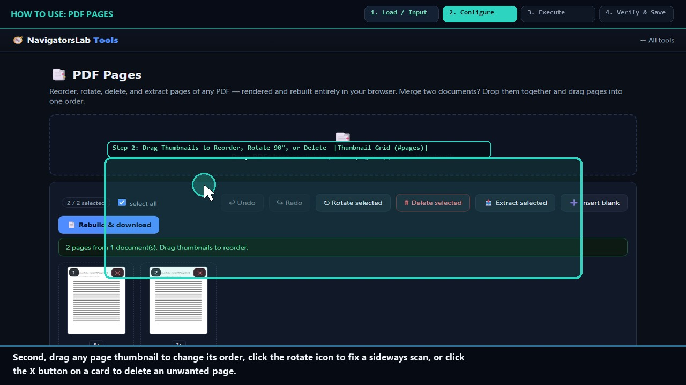
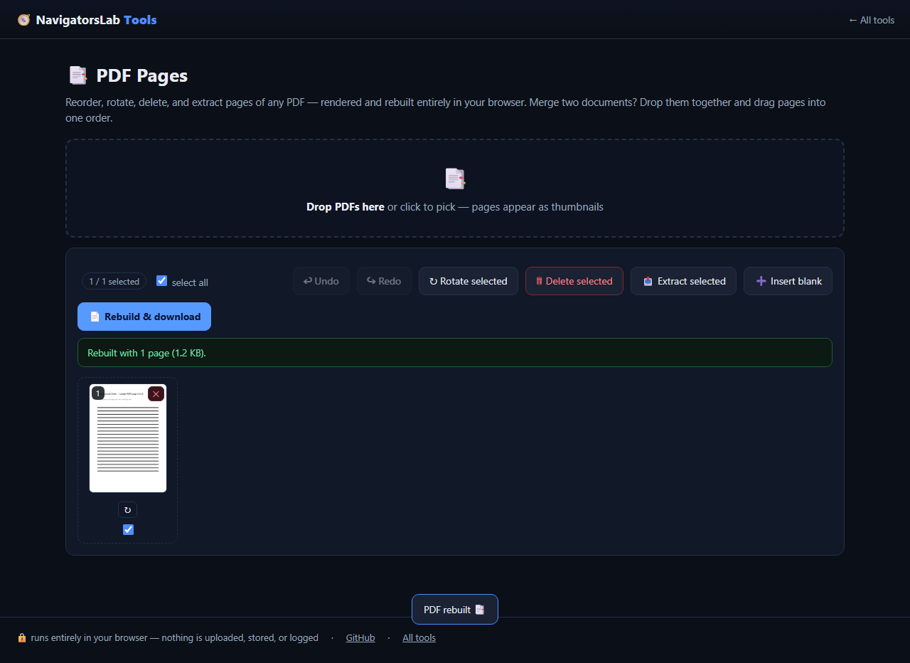

# 📑 PDF Pages

> Reorder, rotate, delete and extract PDF pages

     

<h4 align="center">
  &#9654; <a href="https://navigatorslab.com/tools/pdfpages.html">Open it on navigatorslab.com</a> &mdash; free, no sign-up, nothing uploaded<br>
  <a href="https://navigatorslab.com/PDF-Pages">navigatorslab.com/PDF-Pages</a> &middot; <a href="https://navigatorslab.com/tools/videos/pdfpages.mp4">🔊 Watch Narrated Step-by-Step Tutorial Video</a> &middot; <a href="https://navigatorslab.com/tools/videos/notebooklm-overview.mp4">Watch Full Suite Hands-On Video</a><br>
  This repo's Pages site runs the <em>actual tool</em>: <code>demo.html</code>
</h4>



Reorder, rotate, delete, extract selected pages, insert blank pages, merge documents — live thumbnails, rebuilt with pdf-lib.

## 📖 Complete Step-by-Step User Guide

### Step 1: Drop One or More PDFs to Load Page Thumbnails (`PDF Dropzone (#dz)`)
- **How to do it:** Drag one or more `.pdf` files onto `#dz`. Dropping multiple PDFs appends all of their pages into one unified thumbnail grid.
- **Expected result:** `pdf.js` renders a live visual thumbnail card (`.pp-cell`) for every page.

### Step 2: Drag Thumbnails to Reorder, Rotate 90°, or Delete (`Thumbnail Grid (#pages)`)
- **How to do it:** In `#pages`, drag and drop `.pp-cell` cards to reorder them, click **↻** on a card to rotate that page 90°, or click **× (`.pp-x`)** to remove a page.
- **Expected result:** Page sequence and orientations update visually in real time.

### Step 3: Select Specific Pages or Insert Blank Separator Pages (`Page Checkboxes & Insert Blank (#blank)`)
- **How to do it:** Toggle the checkbox on individual `.pp-cell` cards to pick specific pages for extraction, or click **Insert blank (`#blank`)** to add a clean separator page.
- **Expected result:** Custom page selection or blank separator pages added to the layout.

### Step 4: Rebuild Full PDF or Extract Selected Pages (`Rebuild (#rebuild) & Extract (#extract)`)
- **How to do it:** Click **Rebuild PDF (`#rebuild`)** to download the full reordered/merged document, or **Extract selected (`#extract`)** to export only the checked pages.
- **Expected result:** Lossless vector page copy built via `pdf-lib` and downloaded locally.

## 🎛️ UI Controls, Shortcuts & Parameters Reference

| Control / Shortcut | What It Does |
|---|---|
| `Thumbnail Grid (`#pages` / `.pp-cell`)` | Drag-and-drop visual cards for every page across one or more loaded PDFs. |
| `Per-Page Rotate (`↻`) & Delete (`.pp-x`)` | Rotate individual pages in 90° increments or delete unwanted cover/blank pages. |
| `Insert Blank (`#blank`)` | Inserts a blank separator page into the document sequence. |
| `Rebuild (`#rebuild`) & Extract (`#extract`)` | Exports either the entire modified deck or only the checked pages as a new PDF. |

## 💡 Pro Tips & Real-World Workflows

- 💡 To merge two or three separate PDFs into one packet, simply drop all of them onto `#dz` one after another, drag the thumbnails into order, and click **Rebuild PDF**.
- 💡 Because `pdf-lib` copies page dictionary nodes directly without rasterizing, vector text and embedded fonts stay 100% sharp and searchable.
- 💡 Need deeper in-place text editing, redaction, or OCR on those pages? Open **PDF Studio (`/pdf-studio/`)**.

## 🧪 Concrete Example: Input → Engine → Output

| Stage | What Happens | Details |
|---|---|---|
| **1. Raw Input** | **40-Page Scanned Packet (Pages 2–3 Upside Down)** | Need to rotate pages 2–3 by 180°, delete blank page 4, drag page 5 to front, and merge Attachment-B.pdf |
| **2. On-Device Engine** | **pdf.js renders interactive drag-and-drop page thumbnails; pdf-lib rebuilds clean output document locally** | Runs 100% client-side in your browser tab under strict `CSP` (`connect-src 'none'`). |
| **3. Verified Output** | **Packet-Reordered-Merged.pdf** | Rebuilt PDF with exact new page order, rotations applied in page dictionary, deleted pages purged |

```text
Input: [p1, p2, p3] -> Drag & Rotate 90° -> Output: [p2(90°), p1, p3] (Valid PDF-1.7) [OK]
```

- 🔊 **Narrated Step-by-Step Usage Tutorial Video (`38s`):** [`demo.mp4`](./demo.mp4) (also live at [`https://navigatorslab.com/tools/videos/pdfpages.mp4`](https://navigatorslab.com/tools/videos/pdfpages.mp4))
- 🎬 **Full Suite Hands-On Video Guide:** [`https://navigatorslab.com/tools/videos/notebooklm-overview.mp4`](https://navigatorslab.com/tools/videos/notebooklm-overview.mp4)

## ✅ What it does

- Visual page thumbnails: drag to reorder, rotate or delete
- Extract selected pages, insert blank pages, merge multiple PDFs
- Rebuilt locally with pdf-lib — your originals stay untouched

## 🚀 Try it in 30 seconds

1. Drop one or more PDFs
2. Drag thumbnails: reorder, rotate, delete, merge
3. Download the rebuilt PDF

## 📸 Live UI in action



## 🔒 Private by design

- **100% on-device** — files are processed in your browser and **never uploaded** to any server
- **No accounts, no tracking, no cookies, nothing retained** — open the page and work
- **Works offline** once loaded; fully mobile-friendly
- **Free & open source (MIT)** — use it at home, at work, anywhere

## 🤖 Built for humans *and* AI agents

- Deep-linkable via URL parameters — see the [Agent Mode guide](https://navigatorslab.com/tools/agents.html)
- Machine-readable catalog: [llms.txt](https://navigatorslab.com/tools/llms.txt) · [llms-full.txt](https://navigatorslab.com/tools/llms-full.txt)
- MCP endpoint: `POST https://navigatorslab.com/tools/mcp` (tool catalog + deterministic text tools — see the [main repo](https://github.com/Kayforkind/NavigatorsLab-Tools))
- No build step required to *use* any tool — just the URL

## 🛠 Under the hood

pdf-lib page ops with live thumbnail drag-and-drop

Third-party components are catalogued in [NOTICE](NOTICE); this repo is MIT-licensed ([LICENSE](LICENSE)).

## 🗂 The NavigatorsLab Tools suite

The full catalog — every tool in the hub with the same zero-upload promise, plus the lab's apps, CLIs and engines:

| Tool | What it does | |
|---|---|---|
| 🛡 Photo Privacy Kit | Strip GPS, camera model and timestamps before posting | [Open](https://navigatorslab.com/tools/exif.html) |
| 🔐 Password Breach Checker | Has this password been breached? — it never leaves your tab | [Open](https://navigatorslab.com/tools/breachcheck.html) |
| 🔍 Metadata & Hidden-Data Checker | See what's really inside a file — then strip it | [Open](https://navigatorslab.com/tools/metadata.html) |
| 🗜 Image Shrinker | Hit “max 2 MB” portal limits without TinyPNG | [Open](https://navigatorslab.com/tools/shrink.html) |
| 📄 Scan & Screenshot Cleaner | Phone photos of documents → clean, straight PDFs | [Open](https://navigatorslab.com/tools/scan.html) |
| ✍ Local E-Sign Pad | Sign this lease tonight — not DocuSign | [Open](https://navigatorslab.com/tools/sign.html) |
| 🧾 Receipts → One PDF | Shoebox of receipt photos → one date-sorted PDF | [Open](https://navigatorslab.com/tools/receipts.html) |
| 🔢 Receipt OCR → CSV | Read totals off receipt photos, export for expenses | [Open](https://navigatorslab.com/tools/ocr.html) |
| 🔳 QR Studio | Generate QR codes and decode QR images — no site sees them | [Open](https://navigatorslab.com/tools/qr.html) |
| 🎧 Audio Trimmer | Cut voice notes and clips on a waveform | [Open](https://navigatorslab.com/tools/audio.html) |
| 🧮 Invoice / Quote Generator | One-person shops: hours in, clean PDF out | [Open](https://navigatorslab.com/tools/invoice.html) |
| 🗂 Batch Rename & Sort | IMG_5847.jpg → 2026-09-05-receipt-home-depot.jpg | [Open](https://navigatorslab.com/tools/rename.html) |
| 🖨 Print-Shop Prep | Exact sizes, bleed, DPI checks, print-ready PDF | [Open](https://navigatorslab.com/tools/printprep.html) |
| **📑 PDF Pages** | Reorder, rotate, delete and extract PDF pages | [Open](https://navigatorslab.com/tools/pdfpages.html) |
| 🔬 Text Diff | Compare two texts with word-level highlights | [Open](https://navigatorslab.com/tools/textdiff.html) |
| 🎨 Reimagine | Redesign any HTML page from its own content | [Open](https://navigatorslab.com/reimagine/) |
| 📊 Text Stats | Words, reading time, readability, keyword density | [Open](https://navigatorslab.com/tools/textstats.html) |
| 📜 PDF Studio | Edit the text inside your PDF — private, free, open source | [Open](https://navigatorslab.com/pdf-studio/) |
| 🩺 Design Health | 18 deterministic design-quality checks for HTML — no LLM, no API key | [Open](https://github.com/Kayforkind/design-health-action) |
| 🔪 Skill Slice | Copy one Read-verified skill folder — a slice, not the pie | [Open](https://github.com/Kayforkind/skill-slice) |
| 🕵 liecatchers | Your agent said Done. Prove it — ten sensors, one RECEIPT.json | [Open](https://github.com/Kayforkind/liecatchers) |
| 📚 Book Guide MCP | Ship improvements with your books — agents cite, run playbooks, learn | [Open](https://github.com/Kayforkind/book-guide-mcp) |
| 📡 Data Insights | Founder intelligence — daily & weekly tech signal briefs | [Open](https://github.com/Kayforkind/data-insights) |
| 🪓 Iron Axe: Legacy | An original side-scrolling beat 'em up — Godot 4 | [Open](https://github.com/Kayforkind/iron-axe-legacy) |

---

<p align="center">
  <b>One hub, twenty-four projects:</b> <a href="https://navigatorslab.com/tools/">https://navigatorslab.com/tools</a><br>
  <b>Source &amp; the whole suite:</b> <a href="https://github.com/Kayforkind/NavigatorsLab-Tools">https://github.com/Kayforkind/NavigatorsLab-Tools</a>
</p>
